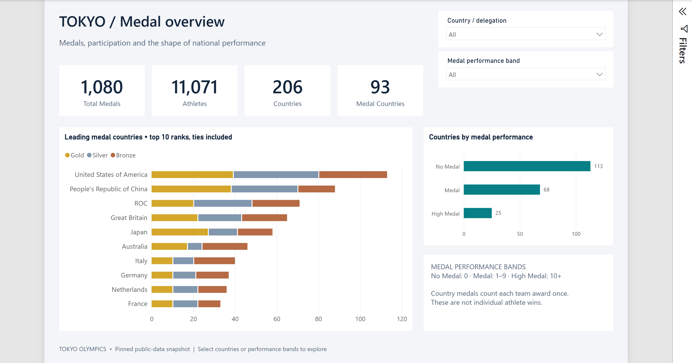
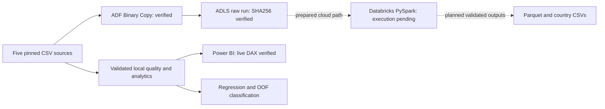

# Tokyo Olympics: Azure Data Engineering, Analytics & ML

This repository validates five Tokyo Olympics CSV datasets, builds country
features and analytics, and contains country-medal ML experiments. Local commands
need no Azure credentials. ADF ingestion is deployed and hash-verified. The native
[Power BI report](powerbi/TokyoOlympics/README.md) has four pages and a validated
embedded snapshot. Databricks Stage 3 is blocked on Entra identity association before job submission; cloud/local
Spark parity and Power BI Service publication are not complete. See the
[completion audit](docs/project-completion.md) for verified results and limits.

## Verified project results

| Component | Evidence-backed status |
| --- | --- |
| Data quality and analytics | Validated transformations and 206-country dataset |
| Azure Data Factory / ADLS | One successful ingestion; all five file hashes verified |
| Power BI Desktop | Four pages, 16 measures; all 206 countries reconciled with live DAX |
| ML | Reproducible regression and OOF classification evaluation |
| Databricks PySpark | Runtime ready; credential validation blocked by Entra identity association; no job submitted |
| Tests | 95 repository tests passing |

[Interview guide](docs/interview-guide.md) · [Power BI setup](powerbi/TokyoOlympics/README.md)
· [Execution and cleanup evidence](docs/azure/progress.md) · [Future extensions](docs/future-roadmap.md)





Solid lines show verified execution. Dotted lines show the implemented cloud path
whose execution is not yet verified. See the [exact identity prerequisite](docs/azure/stage3/identity-prerequisite.md). Power BI currently embeds the validated
local CSV; it is not proof of Databricks execution or a published Service dashboard.

## Prerequisites and tested environment

- Ubuntu or Ubuntu under WSL2; use its Bash shell and Linux Python environment.
- Git and **CPython 3.14.4**, with `venv` and pip support. The tested executable is
  `python3.14`. Ubuntu's default `python3` may be older: provision this Python
  version before continuing if `python3.14 --version` is unavailable or differs.
  Interpreter installation depends on your Ubuntu release and is not automated
  by this project. Do not replace the operating system's Python.
- Linux x86-64 with glibc and the OpenMP runtime (`libgomp.so.1`, supplied by
  Ubuntu's `libgomp1` package). Tested on WSL2 x86-64 with glibc 2.43. Other Python
  versions, architectures and operating systems have not been validated.
- Network access and enough disk space to download the scientific Python wheels.
  The tested Linux XGBoost distribution also depends on the large NCCL runtime
  wheel. The scripts use CPU estimators; a GPU, CUDA toolkit and Azure SDK are
  not required for the local workflow.

The four direct dependencies are pandas 3.0.6, scikit-learn 1.9.1, XGBoost 3.4.1
and joblib 1.6.0. `requirements.txt` pins these versions; `constraints.txt` pins
their tested transitive runtime dependencies, including NumPy 2.5.3 and SciPy
1.18.1. These were selected from source imports and dependency metadata, rather
than copying all installed packages. Tests use Python's standard-library
`unittest`; pytest is not needed. Tested pip: 26.2.1.

`pyproject.toml` records runtime/test metadata only. There is no build backend or
package installation step: use `pip install -r requirements.txt`, not
`pip install .`. The `[tool.tokyo_olympics]` metadata is descriptive and does not
itself enforce the interpreter version. Direct dependencies are defined once.

## Set up the virtual environment

Open a terminal in your checkout. Replace the path below with your actual path.
Run all subsequent commands from this repository root, where `src/` and `data/`
are located. Module invocation (`python -m ...`) ensures local imports resolve.

```bash
cd /path/to/tokyo-olympic-azure-data-engineering-project
python3.14 --version

# Create an environment only if one does not already exist.
if [ ! -d .venv ]; then
    python3.14 -m venv .venv
fi
source .venv/bin/activate
python -c 'import sys; assert sys.version_info[:3] == (3, 14, 4), sys.version; print(sys.executable)'
python -m pip install -r requirements.txt
python -m pip check
```

If an existing `.venv` uses a different interpreter, stop and review it rather
than deleting or recreating it. Activation is needed in each new terminal;
`deactivate` leaves the environment. No packages are installed globally.
Fresh dependency downloading/installation has not been tested in an isolated
environment during this checkpoint; the pins, imports and installed dependency
consistency were verified against the existing environment. Wheel availability
and system-library compatibility still need verification on a new machine.
This is a version-pinned environment, not a hash-verified installation lock.

## Tests and read-only data validation

Run the complete **95-test** suite:

```bash
python -B -m unittest discover -s tests -v
```

Tests use in-memory data and isolated temporary directories without overwriting
repository artifacts. `-B`
prevents Python bytecode-cache writes. To print raw profiles and coach/gender
validation details:

```bash
python -B -m src.quality.data_quality
```

The raw profiler is diagnostic. Use the enforcing gate below to fail on blocking
errors and print the full report, including non-blocking warnings:

```bash
python -B - <<'PY'
from pprint import pprint
from src.quality.gates import load_validated_sources

sources, report = load_validated_sources()
pprint(report)
PY
```

No files are written. `DataQualityError` gives a nonzero exit status on invalid
input and includes the dataset, issue and affected-record samples. Both country
builders call this same gate automatically. Known missing coach events, repeated
athlete names and the unresolved gender-entry discrepancy are warnings.

For an in-memory country-table and dashboard-schema check:

```bash
python -B - <<'PY'
from src.features.build_features import build_country_features
from src.features.build_analytics import build_country_analytics
from src.features.build_powerbi_dataset import prepare_powerbi_dataset

features = build_country_features()
analytics = build_country_analytics()
dashboard = prepare_powerbi_dataset(analytics)
print('Shapes:', features.shape, analytics.shape, dashboard.shape)
print('Medals:', analytics[['Gold', 'Silver', 'Bronze', 'Total']].sum().to_dict())
print('Warnings:', [w['code'] for w in analytics.attrs['data_quality_report']['warnings']])
PY
```

For these repository inputs, expected shapes are `(206, 10)`, `(206, 14)` and
`(206, 16)`. Medal totals are Gold 340, Silver 338, Bronze 402, Total 1,080. These
are dataset-specific checks, not universal validation rules.

## Generate country CSVs and run ML

The following generation commands **overwrite the named saved CSVs**. Run them
only when you intend to replace the saved artifacts. The country CSVs and local
dashboard CSV in this checkpoint match the corrected builders. Run the read-only
checks above first when validating another checkout or changed inputs.

```bash
python -B -m src.features.build_features
python -B -m src.features.build_analytics
```

After deliberately regenerating `models/country_features.csv`, the existing ML
commands are:

```bash
# Selects via training-only CV, then evaluates the winner on holdout; saves nothing.
python -B -m src.ml.train_model

# Same selection/evaluation procedure plus selected-model feature importance.
python -B -m src.ml.analyze_model

# Compares all candidates within training only; does not evaluate holdout.
python -B -m src.ml.cross_validate

# Separate classification OOF evaluation; saves nothing.
python -B -m src.ml.classify_medal_performance
```

`train_model` sorts by country and reserves 20% of countries as holdout with seed
42. Five-fold CV on the remaining training countries compares a fold-training-mean
baseline, Random Forest and XGBoost using identical folds. Lowest mean validation
MAE selects the winner; ties use model name. Only the selected model is refitted
on all training countries and evaluated once on holdout per invocation.
`analyze_model` uses that same procedure and inspects the selected training fit;
it does not load the persisted model. `cross_validate` uses the same reserved
split but stops after training-only CV. Regression estimators use one worker and
fixed seeds. These evaluation commands do not write models, predictions or
directories. To explicitly regenerate the saved model and evaluation evidence:

```bash
python -B -m src.ml.persist_regression
sha256sum models/medal_prediction_model.joblib reports/regression_evaluation.json reports/regression_holdout_predictions.csv
```

This persistence command **replaces these three artifacts**, retaining recoverable
prior copies and checksums under an external `/tmp/tokyo-step17-*` directory.
It reuses the same evaluation pipeline and saves the selected model fitted on
the training partition only (164 countries for the current source), never all
206 countries. Temporary staged artifacts are checked before replacement; write
or final-validation failures restore the prior outputs. The terminal prints the
recovery directory. `/tmp` backups need copying elsewhere for durable retention.
The JSON contains source/model/prediction hashes, feature schema, hyperparameters,
versions, country partitions, all candidate CV results and final holdout metrics.
The prediction CSV has one alphabetically sorted row per holdout country with
`country`, `actual_total`, `predicted_total`, `absolute_error`, using 17 significant
digits and no rounding before metrics. Only the model created by this run is
reloaded for verification; never deserialize an untrusted joblib file.

Classification remains separate: No Medal (0), Medal (1–9) or High Medal (10+)
using one explicit stratified five-fold loop with strict count/country validation,
aligned out-of-fold probabilities and a fold-trained majority baseline. Metrics
are printed, not persisted; the reusable API returns country-level evidence in
memory. See [classification evaluation](docs/classification_evaluation.md) for
class order, undefined-metric handling and exploratory same-Olympics limitations.
To explicitly save classification evidence and a separate full-data demonstration
model (replacing only these three classification artifacts):

```bash
python -B -m src.ml.persist_classification
sha256sum reports/classification_evaluation.json reports/classification_oof_predictions.csv models/medal_classification_model.joblib
```

The report/CSV contain fold-excluded OOF evidence and the fold-trained majority
baseline. The ignored joblib model is separately fitted on all validated countries;
its inference replay is not CV evidence. Prior classification outputs and checksums
are retained outside the repository under `/tmp/tokyo-classification-*`; the
command prints the recovery directory. Staged artifacts are validated before
replacement, with rollback on synchronous replacement/verification errors. Copy
temporary backups elsewhere for durable retention. See the classification document
for exact provenance, trust and crash-recovery limits.
Native-library/platform differences can still affect numerical reproducibility.
The corrected regression procedure was executed on the 206-country feature CSV;
tests also verify split isolation, train-only selection and baseline calculations
using small synthetic estimators. Repeatedly inspecting holdout and changing the
method would invalidate its role as final evaluation. See
[regression evaluation](docs/regression_evaluation.md) for procedure and limits.

Optional CSV preparation for future Power BI work, after generating current
analytics, also **overwrites its output CSV**:

```bash
python -B -m src.features.build_powerbi_dataset
```

This produces a CSV, not a Power BI report or published dashboard. It reads the
saved analytics file, so running it against an old CSV does not repair stale
country/team counts. It drops the retired `medals_per_team_event` field.

## Inputs and outputs

| Path | Role and behavior |
| --- | --- |
| `data/Athletes.csv` | Raw name/country/discipline records |
| `data/Coaches.csv` | Raw coach assignments; Event may be missing |
| `data/EntriesGender.csv` | Raw discipline-level Female/Male/Total entries |
| `data/Medals.csv` | Raw country-level medal totals and ranks |
| `data/Teams.csv` | Raw team entries; verified corrections are applied in memory |
| `models/country_features.csv` | Feature-builder output; input to all four ML scripts |
| `models/country_analytics.csv` | Analytics-builder output; input to dashboard exporter |
| `models/medal_prediction_model.joblib` | Training-partition model from the explicit persistence command; ignored by Git |
| `reports/regression_evaluation.json` | Selection, holdout metrics, partitions, schemas, hashes, versions and limitations |
| `reports/regression_holdout_predictions.csv` | Sorted holdout actual/predicted medal totals and absolute errors |
| `models/medal_classification_model.joblib` | Separate full-data demonstration/inference classifier; ignored by Git |
| `reports/classification_evaluation.json` | Classification OOF/baseline metrics, folds, hashes, versions and final-model provenance |
| `reports/classification_oof_predictions.csv` | Country-sorted OOF labels/probabilities and fold-trained baseline evidence |
| `dashboards/olympic_country_dashboard.csv` | Current corrected exporter output; embedded in the validated native Power BI report |

Local loaders handle the source CSV encodings. Do not bulk-convert or edit raw
files to reproduce the workflow. `.env.example` is empty because the local code
does not read environment credentials; no `.env` file is required.

## Dataset and experiment limitations

- Known country aliases and corrupted Teams text have explicit, documented
  corrections. Unknown replacement characters or unsafe joins block generation.
- Athlete whitespace is trimmed and exact full rows deduplicated. Names are not
  reliable person IDs: `athlete_count` is a distinct-name proxy per country.
- Team counts use composite entries; event counts use discipline/event pairs.
  The removed `medals_per_team_event` KPI cannot be justified because these files
  do not contain team-specific medal outcomes. Other KPI formulas are unchanged.
- Coaches has one redundant row and 145 unspecified Event values. Missing
  assignments are preserved, not guessed.
- Gender totals are 11,316 entries versus 11,085 raw athlete rows (11,084 after
  exact deduplication). Both cover the same 46 disciplines, but the count
  difference is unresolved. Do not infer individual gender or force totals to match.
- ML estimates outcomes across countries within one Games. It does not validate
  future-Olympics forecasting. Selection now uses training-only CV; the holdout
  is reserved for final evaluation. Historical inspection of this dataset means
  this is not an independent external validation. The Step 17 artifact records
  the current training partition and source provenance; the old model is backed
  up without being deserialized. No prospective performance claim is supported.
- Dependencies, tests and local commands do not establish external source
  provenance, current official medal accuracy or a working cloud deployment.

See [automatic gates](docs/data_quality_gates.md),
[country/team definitions](docs/team_counting.md),
[verified Teams corrections](docs/teams_text_corrections.md),
[athlete cleaning](docs/athlete_cleaning.md),
[coach policy](docs/coach_cleaning.md) and
[gender validation](docs/gender_participation.md) for evidence and details.

## Databricks, Azure and Power BI boundary

`Tokyo Olympic Transformation.ipynb` is an older Databricks notebook using
`pyspark`, `spark`, `dbutils`, DBFS mounts and Azure storage. Its saved output
shows Spark 3.3.2; its current configuration contains placeholders and hardcoded
paths. PySpark is not installed in the tested local environment and is deliberately
excluded from local requirements. Adding PySpark alone would not provide the
Databricks/Azure runtime or establish compatibility with this Python environment.

Prepared Azure Data Factory templates, pinned data contracts, a replacement
Databricks transformation and parity checks are now included. One approved ADF
ingestion run succeeded and all five raw output hashes match pinned sources.
Databricks transformation and cloud analytics parity remain unverified. See [Azure progress](docs/azure/progress.md) and
[setup, architecture and approval boundaries](docs/azure/README.md).
Executing the notebook would require a separately configured compatible
Databricks runtime, Azure resources, identities/permissions and verified paths.
The native [Power BI project](powerbi/TokyoOlympics/TokyoOlympics.pbip) includes
four report pages, 16 DAX measures, an embedded CSV snapshot and actual Desktop
captures. Live DAX reconciled all 206 countries and selected-country aggregates.
Open the project in Desktop and Refresh to load a fresh source checkout.
No Power BI Service dashboard has been published. The report uses verified local
analytics, not a successful Databricks output. The verified release is published on `main` on the default branch.

Validate the captured Power BI evidence without cloud access:

```bash
.venv/bin/python -B scripts/verify_powerbi_snapshot.py
```

This checks the frozen source/model/evidence; it does not rerun Desktop DAX or
establish a successful Azure transformation.
